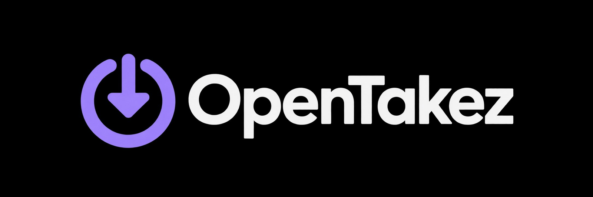

# OpenTakez

All-in-one, self-hosted media downloader. Paste or share a link and get the video, photo, or
audio file.

Supported: YouTube, TikTok, Instagram, Facebook, and SoundCloud, including photo posts,
playlists, and carousels. Spotify is [planned](docs/roadmap.md#planned-spotify).

- **PWA**: install it on your phone, then use *Share → OpenTakez* from any app.
- **Self-hosted**: one Docker container (`linux/amd64` and `linux/arm64`), powered by
  [yt-dlp](https://github.com/yt-dlp/yt-dlp), [gallery-dl](https://github.com/mikf/gallery-dl),
  and ffmpeg.
- **Private by default**: access token, short-lived download tickets, rate limits, read-only
  container. Nobody operates a public instance.
- **Android app**: runs yt-dlp directly on the device, no server needed, or sends links to your
  server. See [docs/android.md](docs/android.md).

Read the [DISCLAIMER](DISCLAIMER.md) before use.

## Quick start

```sh
git clone https://github.com/timhofmann27-bot/OpenTakez.git
cd OpenTakez
cp .env.example .env
docker compose pull
docker compose up -d
docker compose logs opentakez | grep -i token   # the generated access token
```

Open http://localhost:8000 and enter the token. To use it on a phone, serve it over HTTPS, set
`OPENTAKEZ_ALLOWED_HOSTS` to your host name, then in Chrome on Android: menu → *Install app*.

**[Self-hosting guide](docs/self-hosting.md)**: HTTPS with Caddy, Cloudflare Tunnel, all
settings, backups, updating, Raspberry Pi, troubleshooting.
**[Android app](docs/android.md)**: install with Obtainium or APK, engines, pairing, building.
**[Roadmap](docs/roadmap.md)**: Spotify, F-Droid, and other plans.
**[Changelog](CHANGELOG.md)**.

### Limits

Playlists, sets, and carousels are cut off after `OPENTAKEZ_MAX_PLAYLIST_ITEMS` items; channels
and profiles are refused. Files larger than `OPENTAKEZ_MAX_FILE_MB`, or jobs larger than
`OPENTAKEZ_MAX_JOB_MB`, are skipped, and at most `OPENTAKEZ_MAX_QUEUED_JOBS` downloads may be
pending at once. Downloads are deleted after `OPENTAKEZ_FILE_TTL_HOURS`.

### Logins (cookies)

Instagram posts, and some TikTok and Facebook content, can only be loaded while logged in. You
can give the server a login session as a `cookies.txt` file (Settings → Logins in the app):

1. Log in to the site in a desktop browser.
2. Export the cookies in Netscape `cookies.txt` format with a browser extension such as
   "Get cookies.txt LOCALLY".
3. Upload the file for that platform in Settings.

Only cookies that belong to that platform's domains are kept; everything else in the file is
discarded. The result is stored as `/data/cookies/<platform>.txt` with mode 0600 (directory
0700) in the data volume and is never sent to the app or written to logs. For each download the
server hands a temporary copy to the downloader and deletes it afterwards. Delete the cookies in
Settings (or remove the file) at any time.

**Use a secondary account.** Platforms can restrict or ban accounts that automated tools use,
and anyone with access to the data volume or a backup of it can use the session. Never upload
the cookies of your main account. Cookies expire; upload a fresh file when downloads ask for a
login again.

**Image downloads run as the same user as the app.** gallery-dl is a separate program, but it
runs as the app's user, so in principle it could read the stored cookies. This is an accepted
risk: it is pinned to an exact version with hashes (`tools/gallery-dl.txt`), installed in its own
root-owned environment, and started with a clean environment and a config generated per run.

## Android app

A native app that downloads on the phone itself, or through your own server. Share a link from
any app, pick a format, and the file lands in Downloads, Music, or Pictures. Install it with
[Obtainium](https://obtainium.imranr.dev) (add this repository) or download the APK for your
phone from the [releases](https://github.com/timhofmann27-bot/OpenTakez/releases/latest); use
`arm64-v8a` if unsure. Not on Google Play. Details, checksum verification, and building from
source: [docs/android.md](docs/android.md).

A Termux gateway (loopback only, not used by this app) is documented in
[docs/termux.md](docs/termux.md). It is optional and not verified in CI.

## API

All endpoints except `/api/health` need the token as `Authorization: Bearer <token>` (unless
`OPENTAKEZ_ALLOW_NO_TOKEN=true`). The token is never accepted in the URL.

Links that can't send headers (EventSource, `<a href>` downloads) use a **download ticket**:
`POST /api/jobs/{id}/ticket` returns `{"ticket", "expires_at"}`, valid for
`OPENTAKEZ_TICKET_TTL_SECONDS` (600) and only for that job. Pass it as `?ticket=` on the four
routes marked below; it can be reused until it expires (reconnects, range requests). Tickets
become invalid when the server restarts.

| Method | Path | Purpose |
| --- | --- | --- |
| GET | `/api/health` | Version, supported platforms, whether a token is required (no auth) |
| POST | `/api/resolve` | `{"url"}` → title, thumbnail, duration, item count, download options |
| POST | `/api/jobs` | `{"url", "option"}` → start a download job |
| GET | `/api/jobs/{id}` | Job status, progress, and file names |
| POST | `/api/jobs/{id}/ticket` | Short-lived download ticket for this job |
| GET | `/api/jobs/{id}/events` | Server-sent events with the job state until it finishes (Bearer or `?ticket=`) |
| GET | `/api/jobs/{id}/file` | The (first) downloaded file (Bearer or `?ticket=`) |
| GET | `/api/jobs/{id}/files/{index}` | File number `index` (from 0) of a job (Bearer or `?ticket=`) |
| GET | `/api/jobs/{id}/zip` | All files of a job as a streamed ZIP (Bearer or `?ticket=`) |
| DELETE | `/api/jobs/{id}` | Delete a finished job and its files |
| GET | `/api/cookies` | Which platforms have cookies uploaded (never their content) |
| PUT | `/api/cookies/{platform}` | Upload a `cookies.txt` as the raw `text/plain` body |
| DELETE | `/api/cookies/{platform}` | Remove the cookies of a platform |

`url` may be shared text that contains a link. Options: `video-best`, `video-1080`, `video-720`,
`audio-mp3`, `audio-m4a`, `image-original`.

**Rate limits.** Per client IP, `POST /api/resolve`, `POST /api/jobs`, `PUT /api/cookies/*`,
and `POST /api/jobs/{id}/ticket` are limited to `OPENTAKEZ_RATE_LIMIT_PER_MINUTE` (30) requests
per minute. After `OPENTAKEZ_AUTH_FAIL_LIMIT` (10) failed logins within 10 minutes, that IP gets
`429` on all `/api/` routes except `/api/health` for 10 minutes. `429` responses carry a
`Retry-After` header. Behind a reverse proxy, set `OPENTAKEZ_FORWARDED_ALLOW_IPS` so the real
client IP is used.

**Allowed hosts.** With `OPENTAKEZ_ALLOWED_HOSTS` set (JSON list), requests for any other
`Host` get `400`, which protects against DNS rebinding. `/api/health` is exempt so the
container health check keeps working.

## Development

Requirements: Python 3.12+ with [uv](https://docs.astral.sh/uv/), Node 24 with pnpm, ffmpeg, and
[Deno](https://deno.com) (yt-dlp needs a JavaScript runtime for YouTube).

```sh
# Backend on :8000
cd backend
uv sync
uv run uvicorn app.main:app --reload

# PWA on :5173 (proxies /api to :8000, or set OPENTAKEZ_API=http://localhost:8010)
cd web
pnpm install
pnpm dev
```

For local development without a token, start the backend with `OPENTAKEZ_ALLOW_NO_TOKEN=true`.

Checks:

```sh
cd backend && uv run ruff check . && uv run ruff format --check . && uv run pytest
cd web && pnpm lint && pnpm typecheck && pnpm test && pnpm build
cd web && pnpm test:e2e   # Playwright, mocked API (first: pnpm exec playwright install chromium)

# Real downloads from YouTube and SoundCloud (needs network)
cd backend && uv run pytest -m slow
```

Docker image from your checkout:

```sh
docker compose build
# If buildx fails with "unexpected digest" or cache errors, use the default builder:
BUILDX_BUILDER=default docker compose build
```

Dependencies: yt-dlp and the other backend packages are locked in `backend/uv.lock`; gallery-dl
is pinned with hashes in `tools/gallery-dl.txt`, compiled from `tools/gallery-dl.in`. Dependabot
opens update pull requests for both. To update gallery-dl by hand:

```sh
# Edit the version in tools/gallery-dl.in, then:
uv pip compile --generate-hashes --python-version 3.12 -o tools/gallery-dl.txt tools/gallery-dl.in
```

Releases: add the version to `CHANGELOG.md`, then push a tag `vX.Y.Z`. The
[release workflow](.github/workflows/release.yml) builds the amd64 and arm64 image, pushes it to
`ghcr.io/timhofmann27-bot/opentakez`, and creates the GitHub Release.

## Project layout

```
backend/   FastAPI app: API, download jobs, providers (yt-dlp, gallery-dl)
web/       React + Vite PWA (design contract: docs/design/pwa-contract.md)
android/   Native Android app (Kotlin, Compose; see docs/android.md)
tools/     Hash-pinned gallery-dl requirements for the Docker image
docs/      Self-hosting guide, Android guide, roadmap, design contracts
```

## License

[GPL-3.0](LICENSE). gallery-dl (GPL-2.0-only) is shipped as a separate program; see the
[DISCLAIMER](DISCLAIMER.md).
